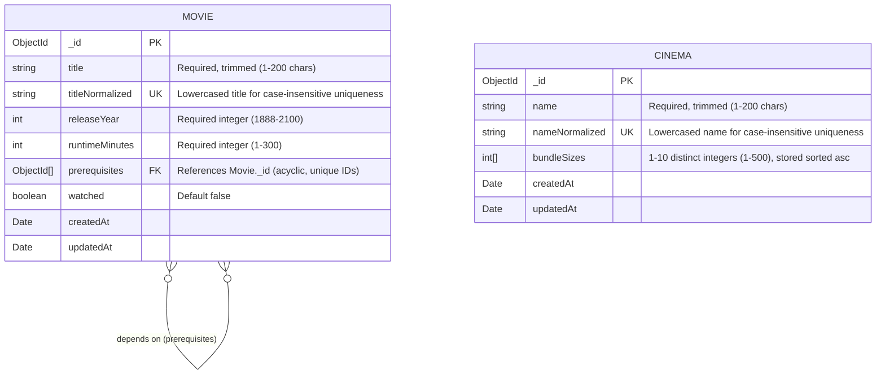

# Doomsday Ready

**Doomsday Ready** is a full-stack web application built for MCU fans preparing for *Avengers: Doomsday*. It solves two core problems:

1. **MCU Rewatch Planning (Feature 1):** Manages a library of movies and their prerequisite graph, blocks circular dependencies of any length, and computes a deterministic topological rewatch order for any target movie along with progress tracking and remaining watch time.
2. **Opening-Night Watch-Party Booking (Feature 2):** Manages cinemas that sell opening-night seats exclusively in fixed group bundles and calculates the fewest bundles that sum to an exact group size with zero empty seats.
3. **Interactive Frontend (Feature 3):** A responsive, dark Marvel-inspired React application with three views (**Movies**, **Rewatch Plan**, and **Booking**) connected to the backend API through a single-origin nginx reverse proxy.

---

## 1. Project Overview & Features

- **Movies & Prerequisite Graph**
  - Create single movies or batches of movies (`POST /api/movies`), list and inspect them, edit prerequisites, toggle `watched` status, and delete movies cleanly (removing dangling references).
  - Enforces case-insensitive trimmed unique titles, integer year/runtime ranges, ObjectId validation, and strict prerequisite validation.
  - Prevents direct self-dependencies and indirect circular dependencies of any length (`409 CIRCULAR_DEPENDENCY`) using a hand-implemented iterative DFS reachability check.
  - Computes a deterministic topological rewatch order (`GET /api/movies/:id/rewatch-order`) using a hand-implemented iterative DFS post-order traversal with shared-prerequisite deduplication (diamond graphs), returning watched count and remaining unwatched runtime.
- **Cinemas & Optimal Watch-Party Booking**
  - Register single or multiple cinemas with 1–10 distinct bundle sizes (1–500 seats each), enforcing case-insensitive unique cinema names and rejecting duplicate/non-integer sizes.
  - Computes the exact minimum-bundle combination (`GET /api/cinemas/:id/booking?groupSize=N`) using a hand-implemented bottom-up Dynamic Programming algorithm with parent-array reconstruction (`O(groupSize * bundleSizes.length)`).
  - Clearly reports impossible seat totals (`HTTP 200` with `possible: false`).
- **Auto-Seeded Sample Data**
  - On first startup, if the `movies` or `cinemas` collections are empty, the backend seeds 8 sample MCU movies (leading up to *Avengers: Doomsday*) and 4 example cinemas.

---

## 2. Tech Stack

- **Backend:** Node.js (ESM), Express 4, MongoDB 7, Mongoose 8, CORS
- **Frontend:** React 19, Vite 6, plain CSS (responsive dark theme)
- **Core Algorithms:** Pure, hand-implemented JavaScript in `backend/src/algorithms/` (zero third-party graph or DP libraries)
- **Testing:** Node.js built-in test runner (`node --test`) + `node:assert/strict`
- **Containerization & Routing:** Docker, Docker Compose, multi-stage Vite + Nginx reverse proxy

---

## 3. How to Run

### Option A: Run Everything with Docker Compose (Recommended — One Command)

Prerequisites: Docker and Docker Compose installed.

```bash
docker compose up --build
```

To run in the background (detached):

```bash
docker compose up --build -d
```

To stop and remove containers (keeping MongoDB data volume):

```bash
docker compose down
```

To stop and reset the seeded database from scratch:

```bash
docker compose down -v
```

#### Service URLs & Ports

| Service  | URL / Address                         | Notes                                                   |
| -------- | ------------------------------------- | ------------------------------------------------------- |
| Frontend | `http://localhost:3000`               | React SPA served by Nginx; proxies `/api/*` to backend  |
| Backend  | `http://localhost:4000/api`           | Direct Express API (also reachable via `:3000/api`)     |
| Health   | `http://localhost:3000/api/health`    | Health check endpoint                                   |
| MongoDB  | `mongodb://localhost:27017`           | Persisted in Docker volume `mongo_data`                 |

---

### Option B: Run Locally Without Docker

Prerequisites: Node.js 20+ (tested on Node 24) and a running MongoDB 7 instance.

1. Copy `.env.example` to `backend/.env` and set `MONGO_URI=mongodb://localhost:27017/doomsday_ready`.
2. Start the backend:
   ```bash
   cd backend
   npm install
   npm run dev
   ```
   The API starts on `http://localhost:4000` and seeds the database automatically if empty.
3. In a second terminal, start the frontend:
   ```bash
   cd frontend
   npm install
   npm run dev
   ```
   The Vite dev server starts on `http://localhost:5173` and proxies `/api` requests to `http://localhost:4000`.

---

### Running Automated Tests

All tests use Node's built-in test runner (`node --test`):

```bash
cd backend
npm test
```

- **Pure algorithm unit tests only:**
  ```bash
  cd backend
  npm run test:algorithms
  ```
- **API tests against a live MongoDB instance** (e.g., while Docker Compose's MongoDB container is running):
  ```bash
  cd backend
  TEST_MONGO_URI=mongodb://localhost:27017/doomsday_ready_test npm run test:api
  ```

---

## 4. API Reference

All API endpoints are served under `/api` (both `http://localhost:3000/api` via Nginx and `http://localhost:4000/api` directly).

### Consistent Error Format

Every error response uses the same JSON envelope:

```json
{
  "error": {
    "code": "CIRCULAR_DEPENDENCY",
    "message": "Updating prerequisites for \"Iron Man\" would create a circular dependency."
  }
}
```

| HTTP Status | Error Code            | Meaning                                                                 |
| ----------- | --------------------- | ----------------------------------------------------------------------- |
| `400`       | `VALIDATION_ERROR`    | Invalid field type/range, malformed ObjectId, duplicate bundle/prereq   |
| `404`       | `NOT_FOUND`           | Movie, cinema, prerequisite movie, or route does not exist              |
| `409`       | `CIRCULAR_DEPENDENCY` | Creating/updating prerequisites would introduce a dependency cycle      |
| `409`       | `DUPLICATE_TITLE`     | Movie title already exists (case-insensitive, trimmed)                  |
| `409`       | `DUPLICATE_NAME`      | Cinema name already exists (case-insensitive, trimmed)                  |

---

### Health Check

#### `GET /api/health`

Response `200 OK`:

```json
{
  "status": "ok",
  "service": "doomsday-ready-backend",
  "timestamp": "2026-11-20T00:45:00.000Z"
}
```

---

### Movies Endpoints

#### `GET /api/movies`

Lists all movies sorted by `releaseYear` ascending, then `title` ascending.

Response `200 OK`:

```json
[
  {
    "id": "673e1a01b2c3d4e5f6070801",
    "title": "Iron Man",
    "releaseYear": 2008,
    "runtimeMinutes": 126,
    "prerequisites": [],
    "watched": false,
    "createdAt": "2026-11-20T00:40:00.000Z",
    "updatedAt": "2026-11-20T00:40:00.000Z"
  }
]
```

#### `GET /api/movies/:id`

Fetches a single movie by ID. Returns `400 VALIDATION_ERROR` for invalid ObjectId format or `404 NOT_FOUND` if missing.

#### `POST /api/movies`

Creates a single movie (JSON object) or a batch of movies (JSON array).

Single request:

```json
{
  "title": "Doctor Strange",
  "releaseYear": 2016,
  "runtimeMinutes": 115,
  "prerequisites": ["673e1a01b2c3d4e5f6070801"],
  "watched": false
}
```

Response `201 Created`:

```json
{
  "id": "673e1a01b2c3d4e5f6070899",
  "title": "Doctor Strange",
  "releaseYear": 2016,
  "runtimeMinutes": 115,
  "prerequisites": ["673e1a01b2c3d4e5f6070801"],
  "watched": false,
  "createdAt": "2026-11-20T00:46:00.000Z",
  "updatedAt": "2026-11-20T00:46:00.000Z"
}
```

Batch request:

```json
[
  { "title": "Doctor Strange", "releaseYear": 2016, "runtimeMinutes": 115 },
  { "title": "Black Panther", "releaseYear": 2018, "runtimeMinutes": 134 }
]
```

Response `201 Created`: returns an array of the created movie objects.

Error example (`409 DUPLICATE_TITLE`):

```json
{
  "error": {
    "code": "DUPLICATE_TITLE",
    "message": "A movie with title \"Iron Man\" already exists."
  }
}
```

#### `PATCH /api/movies/:id`

Partially updates a movie (`title`, `releaseYear`, `runtimeMinutes`, `prerequisites`, and/or `watched`).

Request (mark watched):

```json
{
  "watched": true
}
```

Response `200 OK`: returns the updated movie object.

Error example — setting *Avengers: Endgame* as a prerequisite of *Iron Man* (`409 CIRCULAR_DEPENDENCY`):

```json
{
  "error": {
    "code": "CIRCULAR_DEPENDENCY",
    "message": "Updating prerequisites for \"Iron Man\" would create a circular dependency."
  }
}
```

#### `DELETE /api/movies/:id`

Deletes a movie and removes its ID from any other movie's `prerequisites` array.

Response `200 OK`:

```json
{
  "deleted": true,
  "id": "673e1a01b2c3d4e5f6070899"
}
```

#### `GET /api/movies/:id/rewatch-order`

Returns all transitive prerequisites of the target movie (excluding the target itself) in deterministic topological order, plus progress stats.

Response `200 OK` (for *Avengers: Doomsday*):

```json
{
  "target": {
    "id": "673e1a01b2c3d4e5f6070808",
    "title": "Avengers: Doomsday"
  },
  "order": [
    { "id": "...", "title": "Iron Man", "releaseYear": 2008, "runtimeMinutes": 126, "watched": true },
    { "id": "...", "title": "Captain America: The First Avenger", "releaseYear": 2011, "runtimeMinutes": 124, "watched": true },
    { "id": "...", "title": "The Avengers", "releaseYear": 2012, "runtimeMinutes": 143, "watched": true },
    { "id": "...", "title": "Captain America: Civil War", "releaseYear": 2016, "runtimeMinutes": 147, "watched": false },
    { "id": "...", "title": "Thor: Ragnarok", "releaseYear": 2017, "runtimeMinutes": 130, "watched": true },
    { "id": "...", "title": "Avengers: Infinity War", "releaseYear": 2018, "runtimeMinutes": 149, "watched": false },
    { "id": "...", "title": "Avengers: Endgame", "releaseYear": 2019, "runtimeMinutes": 181, "watched": false }
  ],
  "totalCount": 7,
  "watchedCount": 4,
  "remainingRuntimeMinutes": 477
}
```

Response `200 OK` (for *Thor: Ragnarok*, which has no prerequisites):

```json
{
  "target": {
    "id": "673e1a01b2c3d4e5f6070805",
    "title": "Thor: Ragnarok"
  },
  "order": [],
  "totalCount": 0,
  "watchedCount": 0,
  "remainingRuntimeMinutes": 0
}
```

---

### Cinemas & Booking Endpoints

#### `GET /api/cinemas`

Lists all cinemas sorted by `name` ascending.

Response `200 OK`:

```json
[
  {
    "id": "673e1a01b2c3d4e5f6080001",
    "name": "Asgard Grand Cinema",
    "bundleSizes": [6, 9, 20],
    "createdAt": "2026-11-20T00:40:00.000Z",
    "updatedAt": "2026-11-20T00:40:00.000Z"
  }
]
```

#### `GET /api/cinemas/:id`

Fetches a single cinema by ID.

#### `POST /api/cinemas`

Creates a single cinema (JSON object) or a batch of cinemas (JSON array).

Request:

```json
{
  "name": "Sanctum Dolby Theater",
  "bundleSizes": [2, 5, 10]
}
```

Response `201 Created`:

```json
{
  "id": "673e1a01b2c3d4e5f6080099",
  "name": "Sanctum Dolby Theater",
  "bundleSizes": [2, 5, 10],
  "createdAt": "2026-11-20T00:48:00.000Z",
  "updatedAt": "2026-11-20T00:48:00.000Z"
}
```

Error example — duplicate bundle sizes (`400 VALIDATION_ERROR`):

```json
{
  "error": {
    "code": "VALIDATION_ERROR",
    "message": "Duplicate bundle size 2 is not allowed."
  }
}
```

Error example — duplicate cinema name (`409 DUPLICATE_NAME`):

```json
{
  "error": {
    "code": "DUPLICATE_NAME",
    "message": "A cinema with name \"Quantum Multiplex\" already exists."
  }
}
```

#### `DELETE /api/cinemas/:id`

Deletes a cinema by ID.

#### `GET /api/cinemas/:id/booking?groupSize=11`

Calculates the optimal bundle combination for an exact `groupSize` (`1` to `10,000`).

Response `200 OK` (exact combination found — Quantum Multiplex `[2, 5]`, `groupSize=11`):

```json
{
  "cinema": {
    "id": "673e1a01b2c3d4e5f6080002",
    "name": "Quantum Multiplex"
  },
  "groupSize": 11,
  "possible": true,
  "totalBundles": 4,
  "breakdown": [
    { "size": 5, "count": 1 },
    { "size": 2, "count": 3 }
  ]
}
```

Response `200 OK` (no exact combination — Wakanda Royal Screen `[4, 6]`, `groupSize=7`):

```json
{
  "cinema": {
    "id": "673e1a01b2c3d4e5f6080004",
    "name": "Wakanda Royal Screen"
  },
  "groupSize": 7,
  "possible": false,
  "message": "No exact combination of bundles adds up to 7 seats."
}
```

Error example — invalid `groupSize` (`400 VALIDATION_ERROR`):

```json
{
  "error": {
    "code": "VALIDATION_ERROR",
    "message": "groupSize must be an integer between 1 and 10000."
  }
}
```

---

## 5. Algorithms Explained

All three core algorithms live as pure, framework-free functions in `backend/src/algorithms/` and use **zero** external algorithm libraries.

### 5.1 Cycle Detection (`backend/src/algorithms/cycleDetection.js`)

**Problem:** Model movies as a directed graph where an edge `A -> B` means "movie `A` requires movie `B` to be watched first." When creating or updating movie `M` with proposed prerequisites `P`, we must reject the operation if it introduces any directed cycle.

**How it works:**
1. **Self-loop check:** If `M` is directly in `P`, a 1-node cycle (`M -> M`) exists immediately.
2. **Iterative DFS reachability:** Push all movie IDs in `P` onto an explicit stack and traverse outgoing prerequisite links using a `visited` set. If we ever reach `M`, then `M` is already an ancestor prerequisite of some movie in `P`, so adding `M -> P` closes a cycle.
3. Because the stack is explicit (iterative rather than recursive), deep graphs cannot trigger a JavaScript call-stack overflow.

**Worked Example:** Trying to make *Avengers: Endgame* a prerequisite of *Iron Man*:
- Existing path: `Endgame -> Infinity War -> Civil War -> The Avengers -> Iron Man`.
- Starting DFS from `P = [Endgame]`: pops `Endgame`, pushes `Infinity War`, pops `Infinity War`, pushes `Civil War` & `Thor: Ragnarok`, walks through `Civil War -> The Avengers -> Iron Man`.
- `Iron Man` is reached -> returns `true` -> API responds with `409 CIRCULAR_DEPENDENCY`.

**Complexity:**
- **Time:** `O(V + E)` where `V` is the number of movies and `E` is the number of prerequisite edges reachable from `P`.
- **Space:** `O(V)` for the `visited` set and explicit stack.

---

### 5.2 Topological Rewatch Order (`backend/src/algorithms/rewatchOrder.js`)

**Problem:** Given a target movie `T`, return all transitive prerequisites of `T` (excluding `T` itself), each **exactly once**, ordered so every movie comes **after** all of its own prerequisites.

**How it works (Iterative DFS Post-Order):**
1. Maintain a `visited` set initialized with `{ targetId }` (guaranteeing the target itself is never emitted) and an explicit stack of frames `{ id, expanded }`.
2. Sort each movie's prerequisites deterministically by `releaseYear` ascending, then case-insensitive `title` ascending, then `id` ascending.
3. Seed the stack with `T`'s sorted prerequisites pushed in **reverse** order (so the earliest prerequisite is popped first).
4. Loop while the stack is non-empty:
   - When popping `{ id, expanded: false }`: skip if already in `visited`; otherwise mark `visited`, push `{ id, expanded: true }` back onto the stack (post-order marker), then push its unvisited sorted prerequisites in reverse order.
   - When popping `{ id, expanded: true }`: every prerequisite of `id` has already finished and been emitted, so append `id` to `order`.
5. Shared prerequisites in diamond graphs (e.g., `D -> [B, C]`, `B -> [A]`, `C -> [A]`) are marked in `visited` the first time they are explored, so `A` appears exactly once before both `B` and `C`.
6. Finally, scan `order` once to tally `totalCount`, `watchedCount`, and `remainingRuntimeMinutes` (sum of runtimes of unwatched movies).

**Worked Example:** Target = *Avengers: Doomsday*:
- Explores `Endgame -> Infinity War -> Civil War -> The Avengers -> Iron Man`, emits `Iron Man` (2008), then `Captain America: The First Avenger` (2011), then `The Avengers` (2012), then `Captain America: Civil War` (2016), then visits the second branch of `Infinity War` (`Thor: Ragnarok`, 2017), emits `Avengers: Infinity War` (2018), and finally `Avengers: Endgame` (2019).

**Complexity:**
- **Time:** `O(V + E + E log D)`, where `V` and `E` are reachable movies/edges and `D` is the maximum number of direct prerequisites per movie (due to deterministic sorting).
- **Space:** `O(V)` for lookup map, `visited`/`emitted` sets, and stack.

---

### 5.3 Minimum Seat Bundles (`backend/src/algorithms/minBundles.js`)

**Problem:** Given distinct bundle sizes `B = [b_1, ..., b_k]` and a target `groupSize = G`, find the smallest number of bundles whose sizes sum to **exactly** `G`, plus how many of each bundle size to purchase. (Note: greedy algorithms fail here—for example, with bundles `[1, 3, 4]` and `G = 6`, greedy picks `4 + 1 + 1` (3 bundles) whereas optimal is `3 + 3` (2 bundles).)

**How it works (Bottom-Up Dynamic Programming + Parent Array):**
1. Allocate two typed `Int32Array`s of length `G + 1`:
   - `dp[s]`: minimum number of bundles needed for exactly `s` seats (initialized to `INF = G + 1`, except `dp[0] = 0`).
   - `choice[s]`: the bundle size last added to achieve the optimal `dp[s]` (initialized to `-1`).
2. Sort bundle sizes descending (so ties deterministically favor larger bundles).
3. For each seat count `s` from `1` to `G`, try every bundle size `b <= s`:
   - If `dp[s - b] + 1 < dp[s]`, update `dp[s] = dp[s - b] + 1` and `choice[s] = b`.
4. If `dp[G] >= INF`, no exact combination exists -> return `{ possible: false, message }`.
5. **Reconstructing the breakdown:** Start at `remaining = G`. While `remaining > 0`, read `b = choice[remaining]`, increment the count for size `b`, and set `remaining -= b`. Return the counts sorted descending by bundle size.

**Worked Example:** Bundles `[2, 5]`, `groupSize = 11`:

| Seats `s` | 0 | 1 | 2 | 3 | 4 | 5 | 6 | 7 | 8 | 9 | 10 | 11 |
| --------- | - | - | - | - | - | - | - | - | - | - | -- | -- |
| `dp[s]`   | 0 | ∞ | 1 | ∞ | 2 | 1 | 3 | 2 | 4 | 3 | 2  | 4  |
| `choice[s]` | -1 | -1 | 2 | -1 | 2 | 5 | 2 | 5 | 2 | 5 | 5 | 5 |

Reconstructing from `remaining = 11`:
- `choice[11] = 5` -> count(5) = 1, `remaining = 6`
- `choice[6] = 2` -> count(2) = 1, `remaining = 4`
- `choice[4] = 2` -> count(2) = 2, `remaining = 2`
- `choice[2] = 2` -> count(2) = 3, `remaining = 0`

Result: `4` bundles -> `5 x 1, 2 x 3` (`5 + 2 + 2 + 2 = 11`).

**Complexity:**
- **Time:** `O(groupSize * bundleSizes.length)`. With max `groupSize = 10,000` and max `10` bundle sizes, that is at most 100,000 simple integer operations (~2–4 ms in Node.js).
- **Space:** `O(groupSize)` for `dp` and `choice`.

---

## 6. Data Model Diagram



**Field notes:**
- `MOVIE.titleNormalized` and `CINEMA.nameNormalized` back MongoDB unique indexes so case-insensitive uniqueness (`"Iron Man"` vs `"  iron man  "`) is enforced at both the validation layer and the database index layer. Both internal fields are stripped from API JSON responses, and `_id` is exposed as `id`.
- `MOVIE.prerequisites` forms a Directed Acyclic Graph (DAG) over `MOVIE` documents.

---

## 7. Assumptions & Decisions

Where the specification left room for interpretation, the following explicit decisions were made:

1. **Duplicate bundle sizes:** Rejected with `400 VALIDATION_ERROR` (e.g., `[2, 5, 2]` fails rather than silently deduplicating). Bundle sizes are stored sorted ascending for consistent display.
2. **Duplicate prerequisite IDs:** Rejected with `400 VALIDATION_ERROR` when the same movie ID appears more than once inside a single `prerequisites` array (consistent with rejecting duplicate bundle sizes).
3. **Case-insensitive uniqueness:** Both `Movie.title` and `Cinema.name` are trimmed and compared case-insensitively (`409 DUPLICATE_TITLE` / `409 DUPLICATE_NAME`).
4. **Impossible booking combinations:** Returned as `HTTP 200` with `{ cinema, groupSize, possible: false, message }` because "no exact bundle match exists" is a valid domain outcome of the calculation rather than a malformed client request.
5. **Prerequisite references:** Referenced by MongoDB ObjectId string (`24` hex chars). Invalid ObjectId syntax returns `400 VALIDATION_ERROR`; valid syntax that does not match an existing movie returns `404 NOT_FOUND`.
6. **Batch creation (`POST /api/movies` and `POST /api/cinemas`):** Accepts either a single JSON object (returns `201` with the created object) or a non-empty JSON array (returns `201` with an array of created objects). Empty arrays return `400 VALIDATION_ERROR`. Validation (including intra-batch duplicate titles/names and prerequisite checks) runs upfront so invalid batches fail cleanly without partial inserts.
7. **Movie year & runtime ranges:** `releaseYear` accepts integers from `1888` (the year of the earliest surviving motion picture) through `2100`; `runtimeMinutes` accepts integers from `1` through `300`. *Avengers: Doomsday* is seeded with `2026` and a realistic placeholder runtime of `160` minutes.
8. **Deterministic rewatch ordering:** Sibling prerequisites are sorted by `releaseYear` ascending, then `title` (case-insensitive) ascending, then `id` ascending.
9. **Booking tie-breaking & formatting:** When multiple combinations share the exact same minimum bundle count, the DP deterministically prefers larger bundles; the `breakdown` array is returned sorted descending by bundle size.
10. **Movie deletion (`DELETE /api/movies/:id`):** Deleting a movie automatically pulls its ID out of any other movie's `prerequisites` array so the dependency graph never contains dangling IDs.
11. **Startup seeding:** Runs on backend boot independently per collection—only seeding `movies` if `movies` is empty and only seeding `cinemas` if `cinemas` is empty.
12. **Offline vs. MongoDB test execution:** `npm test` runs both pure algorithm unit tests and full HTTP API tests immediately without requiring a local MongoDB daemon (via an in-memory repository implementing the exact same contract as the Mongoose repository). Setting `TEST_MONGO_URI` runs the exact same API test suite against real MongoDB.

---

## 8. Project Structure

```text
.
├── .dockerignore
├── .env.example
├── .gitignore
├── README.md
├── docker-compose.yml
├── backend/
│   ├── .dockerignore
│   ├── Dockerfile
│   ├── package.json
│   ├── src/
│   │   ├── algorithms/
│   │   │   ├── cycleDetection.js      # Pure iterative DFS cycle detection
│   │   │   ├── minBundles.js          # Pure bottom-up DP minimum bundles
│   │   │   └── rewatchOrder.js        # Pure iterative DFS post-order toposort
│   │   ├── app.js                     # Express app factory (CORS, routes, error handler)
│   │   ├── controllers/
│   │   │   ├── cinemasController.js
│   │   │   └── moviesController.js
│   │   ├── errors/
│   │   │   └── AppError.js
│   │   ├── middleware/
│   │   │   └── errorHandler.js
│   │   ├── models/
│   │   │   ├── Cinema.js
│   │   │   └── Movie.js
│   │   ├── repositories/
│   │   │   ├── memoryRepositories.js
│   │   │   └── mongoRepositories.js
│   │   ├── routes/
│   │   │   ├── cinemasRoutes.js
│   │   │   └── moviesRoutes.js
│   │   ├── seed/
│   │   │   └── seedData.js
│   │   ├── server.js                  # MongoDB connection, seeding, HTTP server
│   │   └── validators/
│   │       ├── cinemaValidator.js
│   │       └── movieValidator.js
│   └── tests/
│       ├── algorithms.test.js         # Unit tests for all 3 pure algorithms
│       └── api.test.js                # End-to-end HTTP API tests
└── frontend/
    ├── .dockerignore
    ├── Dockerfile                     # Multi-stage Vite build + Nginx runtime
    ├── index.html
    ├── nginx.conf                     # SPA routing + /api reverse proxy
    ├── package.json
    ├── vite.config.js
    └── src/
        ├── App.jsx
        ├── api/
        │   └── client.js
        ├── components/
        │   ├── BookingView.jsx
        │   ├── MoviesView.jsx
        │   └── RewatchPlanView.jsx
        ├── index.css
        ├── main.jsx
        └── utils/
            └── formatters.js
```

---

## 9. AI Usage Disclosure

I did not write any code, tests, configuration, or documentation in this repository by hand—not even a single word. The entire project, including the backend, frontend, Feature 1 cycle detection and topological rewatch-order logic, Feature 2 dynamic programming minimum-bundle logic, automated tests, Docker and Nginx setup, and this README, was generated by an AI coding agent (**Google Antigravity**) from prompts that I wrote.

My role was strictly to write the prompt, approve the implementation plan, run the project, review its behavior against the requirements, and submit it.

No third-party library is used anywhere in this project for the cycle detection, topological rewatch ordering, or minimum-bundle algorithms; all three are implemented directly as standalone pure JavaScript functions inside `backend/src/algorithms/`.

---

## 10. Appendix: The Prompt Used

````text
First, write a short implementation plan and wait for my approval before writing any code.

You are building a complete, production-quality submission for the "Blinto Talent Accelerator 2027" Full-Stack Developer Internship assessment. Build everything described below from scratch in one Git repository, run it, test it, and fix any problems yourself before you finish.

======================================================
PROJECT: "Doomsday Ready"
======================================================
A small full-stack app that helps MCU fans plan their rewatch before "Avengers: Doomsday" and book an opening-night watch party. Many MCU movies build on earlier ones, so fans need to know what to rewatch and in what order. Cinemas sell opening-night seats only in group bundles.

TECH STACK (use exactly this)
- Backend: Node.js + Express + MongoDB (Mongoose)
- Frontend: React (Vite)
- Docker Compose to start everything with ONE command: `docker compose up --build`
- Plain JavaScript is fine. Keep the code clean, modular, and commented where the logic is non-obvious.

HARD RULES
1. The core algorithms for Feature 1 (cycle detection + rewatch order) and Feature 2 (minimum bundles) MUST be hand-implemented as pure functions in their own files. Do NOT use any library that solves these problems (no graph/toposort/cycle libraries, no coin-change/knapsack/optimization libraries).
2. Put the pure algorithms in `backend/src/algorithms/` (e.g. `cycleDetection.js`, `rewatchOrder.js`, `minBundles.js`) so they are independent of Express/Mongo and easy to unit test.
3. Where the spec is unclear, make a reasonable choice and document it in the README under "Assumptions".

======================================================
FEATURE 1: Movies and Rewatch Order
======================================================
Movie fields:
- title: string, required, UNIQUE (case-insensitive uniqueness, trim whitespace)
- releaseYear: integer, required (reasonable range, e.g. 1888 to 2100)
- runtimeMinutes: integer, required, 1 to 300 inclusive
- prerequisites: array of movie IDs (optional, default empty, can be changed later via PATCH)
- watched: boolean, default false, can be updated

Validation:
- A movie can NEVER depend on itself, directly or through other movies (any cycle, any length).
- Reject any create or update that would cause a cycle with HTTP 409 and error code `CIRCULAR_DEPENDENCY`.
- Also validate: prerequisite IDs must exist (400/404 with clear code), no duplicate IDs inside prerequisites (dedupe or reject, pick one and document it), runtime/year ranges, invalid ObjectId format, duplicate title -> 409 `DUPLICATE_TITLE`.
- Cycle check must run on BOTH create and update. Implement it with your own DFS/BFS over the in-memory graph: when setting prerequisites P for movie M, a cycle exists if M is reachable from any movie in P by following prerequisite links (or if M is in P).

Rewatch Order (GET /api/movies/:id/rewatch-order):
- Return every movie needed before the target: its prerequisites, their prerequisites, and so on, each EXACTLY ONCE, in an order where every movie comes after all of its own prerequisites (topological order).
- Do NOT include the target itself.
- Also return how many of those movies are watched, and the total runtime (minutes) of the UNWATCHED ones.
- Implement with a hand-written DFS post-order topological sort (iterative preferred, to avoid recursion depth problems) with a visited set so shared prerequisites appear once. Make the output deterministic (e.g. visit prerequisites sorted by releaseYear then title).
- Suggested response shape:
  {
    "target": { "id", "title" },
    "order": [ { "id", "title", "releaseYear", "runtimeMinutes", "watched" }, ... ],
    "totalCount": 7,
    "watchedCount": 4,
    "remainingRuntimeMinutes": 345
  }

Sample data (seed the DB with this on first startup if the movies collection is empty; it is sample data, not an official watch guide). Use realistic release years and runtimes:
- Iron Man: prerequisites none
- Captain America: The First Avenger: none
- The Avengers: Iron Man, Captain America: The First Avenger
- Captain America: Civil War: The Avengers
- Thor: Ragnarok: none
- Avengers: Infinity War: Captain America: Civil War, Thor: Ragnarok
- Avengers: Endgame: Avengers: Infinity War
- Avengers: Doomsday: Avengers: Endgame

Expected results that MUST pass (write automated tests for these):
- Rewatch order for Avengers: Doomsday -> all 7 other movies in a valid order (e.g. Iron Man, The First Avenger, The Avengers, Civil War, Ragnarok, Infinity War, Endgame)
- Rewatch order for Captain America: Civil War -> Iron Man and The First Avenger (either order), then The Avengers
- Rewatch order for Thor: Ragnarok -> empty list
- Making Avengers: Endgame a prerequisite of Iron Man -> 409 CIRCULAR_DEPENDENCY
- Also test: self-dependency, a longer indirect cycle, diamond-shaped dependencies (shared prerequisite appears once).

======================================================
FEATURE 2: Cinemas and Watch-Party Booking
======================================================
Cinema fields:
- name: string, required, UNIQUE (case-insensitive, trimmed)
- bundleSizes: array of integers, between 1 and 10 DIFFERENT sizes, each between 1 and 500 inclusive. Reject duplicates with a clear 400 error (document this choice), reject non-integers.

Booking Quote (GET /api/cinemas/:id/booking?groupSize=6):
- groupSize: integer 1 to 10,000, otherwise 400 `VALIDATION_ERROR`.
- Return the FEWEST bundles whose seats add up to EXACTLY the group size (nobody pays for an empty seat), plus how many of each size to buy.
- If no exact combination exists, say so clearly (HTTP 200 with `possible: false` and a message; document this choice).
- Implement with hand-written bottom-up dynamic programming (minimum-coin-change style) with a parent/choice array to reconstruct the counts. No libraries. Complexity O(groupSize * bundleSizes).
- Suggested response shape:
  {
    "cinema": { "id", "name" },
    "groupSize": 11,
    "possible": true,
    "totalBundles": 4,
    "breakdown": [ { "size": 5, "count": 1 }, { "size": 2, "count": 3 } ]
  }
  or { ..., "possible": false, "message": "No exact combination of bundles adds up to 7 seats." }

Expected results that MUST pass (write automated tests):
- Bundles 1,3,4 / group 6 -> 2 bundles: 3 x 2
- Bundles 2,5 / group 11 -> 4 bundles: 5 x 1, 2 x 3
- Bundles 6,9,20 / group 44 -> 4 bundles: 20 x 1, 9 x 2, 6 x 1
- Bundles 4,6 / group 7 -> not possible
- Also test: group size equals a bundle size, bundle size 1 present, group size 10,000 performance, largest bundle 500.
Seed these four example cinemas (with sensible names) on first startup if the cinemas collection is empty.

======================================================
FEATURE 3: Frontend (React)
======================================================
A clean, modern, responsive React app (dark "Marvel-like" theme is welcome but keep it readable) using the API, with three views switched by a top navigation:
1. Movies: list movies; add a movie (form with validation); edit a movie's prerequisites (multi-select of other movies); tick/untick watched. Show API errors clearly (e.g. a friendly message for CIRCULAR_DEPENDENCY and DUPLICATE_TITLE).
2. Rewatch Plan: pick a target movie; show the ordered list with watched ticks (ticking should update the backend), a progress bar with text like "4 of 7 watched", and the remaining watch time (format as "Xh Ym"). Handle the empty list case with a friendly message.
3. Booking: pick a cinema (also allow creating a cinema with a bundle-sizes form), enter a group size, and show the bundles to buy (e.g. "5 x 1, 2 x 3 - 4 bundles") or a clear "Not possible" message.
Include loading states, empty states, and error states. Use fetch or axios for API calls (a library is fine here; only the algorithms must be hand-written).

======================================================
API (all under /api)
======================================================
POST /movies                      Create movie(s) (accept a single object or an array)
GET /movies                       List movies
PATCH /movies/:id                 Update movie incl. watched and prerequisites
GET /movies/:id/rewatch-order     Rewatch order
POST /cinemas                     Create cinema(s) (accept a single object or an array)
GET /cinemas                      List cinemas
GET /cinemas/:id/booking?groupSize=6   Booking quote
You may add extras (e.g. GET /movies/:id, GET /cinemas/:id, DELETE), plus GET /api/health.
Use a consistent error format: { "error": { "code": "CIRCULAR_DEPENDENCY", "message": "..." } } with correct status codes (400 VALIDATION_ERROR, 404 NOT_FOUND, 409 CIRCULAR_DEPENDENCY / DUPLICATE_TITLE / DUPLICATE_NAME). Add a central error handler and request validation. Enable CORS appropriately.

======================================================
DOCKER AND PROJECT STRUCTURE
======================================================
- `docker-compose.yml` with services: mongo (with a volume), backend, frontend (built and served via nginx, proxying /api to the backend so the browser only needs one origin). `docker compose up --build` must bring up the whole app; document the URLs/ports.
- Provide Dockerfiles for backend and frontend, `.dockerignore`, `.gitignore`, and `.env.example`.
- Structure: /backend, /frontend, docker-compose.yml, README.md at the root.
- Backend tests: use Node's built-in test runner (`node --test`) or Jest. Unit-test the algorithms and API-level tests for the key behaviours. Run them and make sure everything passes.
- Initialize git and make clean, meaningful commits (e.g. "feat: movies API", "feat: booking DP", "feat: frontend", "docs: README"). Do not commit node_modules or secrets.

======================================================
README.md (VERY IMPORTANT, write it thoroughly)
======================================================
The README must contain these sections:
1. Project overview and features
2. Tech stack
3. How to run: with Docker Compose (one command), and locally without Docker; how to run the tests; URLs/ports
4. API reference with example requests and responses for every endpoint, including error cases
5. Algorithms explained in plain language with time complexity: cycle detection, topological rewatch order (DFS post-order), and the DP minimum-bundle solution (including how the parent array reconstructs the answer), with a worked example
6. Data model diagram (BONUS): a Mermaid ER diagram showing Movie (with the self-referencing prerequisites relationship) and Cinema (with bundleSizes), plus short field notes
7. Assumptions and decisions (every ambiguous choice you made: e.g. duplicate bundle sizes rejected, case-insensitive uniqueness, "not possible" returned as 200, prerequisites referenced by ID, batch create behaviour, year range, deterministic ordering)
8. Project structure
9. "AI Usage Disclosure" section. This section MUST state honestly and plainly, in the first person, that: the author did not write any code, tests, configuration or documentation by hand, not even a single word; the ENTIRE project (backend, frontend, algorithms, tests, Docker setup and this README) was generated by an AI coding agent (Google Antigravity) from prompts written by the author; and the author's role was to write the prompt, run the project, review the behaviour, and submit it. State this clearly and without hedging, including for the Feature 1 and Feature 2 logic. Also state that no third-party library is used for the cycle detection, topological ordering, or minimum-bundle algorithms.
10. "Appendix: The Prompt Used". Include THIS ENTIRE PROMPT, verbatim, inside a fenced code block, so reviewers can see exactly what was asked.

======================================================
DEFINITION OF DONE
======================================================
- `docker compose up --build` works from a clean clone and the app is usable at the documented URL, with seeded sample data.
- All tests pass, including every expected result listed above.
- All 3 frontend views work end to end against the API.
- README is complete with all 10 sections above.
- Before finishing, actually run the app and tests, verify all the expected results manually through the API, and fix anything broken. Then give me a short summary of what you built, how to run it, and any assumptions you made.
````
